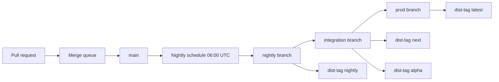

# Trunk-based release pipeline

`@openpacker/cli` is the only package published to npm. The manual alpha
commands stay in the repository root [RELEASING.md](../RELEASING.md). This
document is the trunk and promotion pipeline: merge queue on `main`, a scheduled
nightly, then fast-forward promotion to `integration` and `prod`.

The legacy [cd.yml](../.github/workflows/cd.yml) workflow is deprecated. Do not
add triggers to it. New releases use the `promote-*.yml` workflows below.

## Flow



| Stage       | Git ref       | Workflow                                                                | npm dist-tag                           |
| ----------- | ------------- | ----------------------------------------------------------------------- | -------------------------------------- |
| Merge       | `main`        | [trunk-gate.yml](../.github/workflows/trunk-gate.yml)                   | none                                   |
| Nightly     | `nightly`     | [promote-nightly.yml](../.github/workflows/promote-nightly.yml)         | `nightly`                              |
| Integration | `integration` | [promote-integration.yml](../.github/workflows/promote-integration.yml) | `next` and `alpha` on the same version |
| Production  | `prod`        | [promote-prod.yml](../.github/workflows/promote-prod.yml)               | `latest`                               |

`main` moves only through the merge queue. `nightly`, `integration`, and `prod`
move by fast-forward to a commit that is already on the previous stage.
Promotion workflows do not force-push.

## Merge queue

Pull requests targeting `main` run
[ci-advisory.yml](../.github/workflows/ci-advisory.yml). That job is fast
(format and anti-slop lint on Ubuntu with Node 22) and is not a required check.
Its job summary says the merge queue runs Trunk gate.

The only required status check is:

```text
Trunk gate / Required merge queue gate
```

That string is the workflow name, a slash, and the job name from
[trunk-gate.yml](../.github/workflows/trunk-gate.yml). The same job runs on
`merge_group` and on `pull_request` targeting `main`, with
`OPENPACKER_OFFLINE=1` and `SOURCE_DATE_EPOCH=1785628800`, in this order:

1. `npm run format:check`
2. `npm run lint:anti-slop`
3. `npm run typecheck`
4. `npm run build`
5. `npm test` (root unit gate)
6. `npm test --workspace @openpacker/cli -- test/release-bundle.test.ts`

Node is 22.19.0, Rust is 1.88.0 with the `wasm32-unknown-unknown` target, and
`wasm-bindgen-cli` 0.2.126 is cached the same way as
[ci-build.yml](../.github/workflows/ci-build.yml). The composite
[openpacker-build](../.github/actions/openpacker-build/action.yml) action
performs that setup for other jobs. Its `node-version` input defaults to
`22.19.0`.

After the squash merge lands on `main`,
[ci-build.yml](../.github/workflows/ci-build.yml) builds the OS and Node matrix
and uploads pack artifacts. It does not run on pull requests.

## Nightly

[promote-nightly.yml](../.github/workflows/promote-nightly.yml) runs at 06:00
UTC (`0 6 * * *`) and on `workflow_dispatch`. The job uses the GitHub
Environment `nightly`.

It checks out `main` with full history and skips when `HEAD` has no commits
after the newest tag matching `cli-v*-nightly.*`. Otherwise it runs
`npm run verify` and `npm run test:integration`, then publishes.

The npm version is `${base}-nightly.${YYYYMMDD}` in UTC. `base` is the
`apps/openpacker-cli/package.json` version with the prerelease and build
metadata removed. `0.0.1-alpha.1` on 2026-10-31 becomes
`0.0.1-nightly.20261031`. The bundle reads that string from
`OPENPACKER_RELEASE_VERSION`.

Publish uses npm trusted publishing from `apps/openpacker-cli/release`:

```sh
npm publish --provenance --access public --tag nightly
```

The workflow then creates the git tag `cli-v${VERSION}`, pushes that tag, and
fast-forwards `nightly` with `git push origin SHA:refs/heads/nightly`.

Leave the `nightly` environment without required reviewers so the schedule can
finish. Restrict deployment branches to `main` if you set a branch policy. The
schedule runs the workflow on `main`.

## Integration

[promote-integration.yml](../.github/workflows/promote-integration.yml) accepts
`workflow_dispatch` input `nightly_sha` and also listens for a successful
`workflow_run` of Promote nightly. The run is skipped when that SHA is already
the `integration` tip.

`nightly_sha` must be an ancestor of the `nightly` tip. The workflow then runs:

- a matrix of `ubuntu-latest`, `windows-latest`, and `macos-latest` against Node
  `22.19.0` and `24`: `npm ci`, `npm run build`, `npm run test:integration`,
  `npm run test:e2e`, and `npm run test:conformance`
- an Ubuntu supply-chain job: `npm run check:licenses`,
  `npm run security:codex:dry-run` when the reviewed `codex-security` CLI is
  installed, otherwise the in-repo equivalent (`npm run security:codex:test` and
  `npm run test:security`), gitleaks, and `npm audit --audit-level=high` on the
  release bundle's external dependencies

The publish job uses the GitHub Environment `integration`. It bundles the same
nightly version, publishes it with `--tag next` when that version is not already
on the registry, then runs:

```sh
npm dist-tag add @openpacker/cli@${VERSION} next
npm dist-tag add @openpacker/cli@${VERSION} alpha
```

`next` and `alpha` point at the nightly version that just passed the matrix. The
job then fast-forwards `integration` to `nightly_sha` and refuses a
non-fast-forward.

## Production

[promote-prod.yml](../.github/workflows/promote-prod.yml) runs only on
`workflow_dispatch` with a required `integration_sha`. It has no `push` trigger.
The GitHub Environment `production` must require Tyler as a reviewer. GitHub
stores that reviewer on the environment; the workflow file cannot name the
person.

`integration_sha` must be the current tip of `integration`, and `prod` must be
an ancestor of that commit when `prod` already exists. The promotion job then
runs, in order:

1. `npm run verify`
2. [changelog-entry-check.mjs](../scripts/release/changelog-entry-check.mjs)
3. [semver-gate.mjs](../scripts/release/semver-gate.mjs) `--prod`
4. [npm-pack-gate.mjs](../scripts/release/npm-pack-gate.mjs)
5. `npm sbom --sbom-format cyclonedx`
6. `npm audit --audit-level=high` on the workspace and on the release bundle
7. `semver-gate.mjs --no-prerelease-deps` on
   `apps/openpacker-cli/release/package.json`
8. `actions/attest-build-provenance` on the release tarball
9. fast-forward `prod` to `integration_sha`
10. `npm publish --provenance --access public --tag latest`

`--prod` rejects a prerelease. The version published to `latest` is the version
committed in `apps/openpacker-cli/package.json`, not the nightly override. Bump
that field to a stable semver (for example `0.1.0`), add a matching changelog
heading, merge it through the queue, promote that commit through nightly and
integration, and only then dispatch production.

A production environment deployment-branch rule must allow `main`. Dispatch runs
the workflow file from `main`. Limiting the environment to the `prod` branch
blocks the job.

## Release scripts

| Script                                                                    | Behavior                                                                                         |
| ------------------------------------------------------------------------- | ------------------------------------------------------------------------------------------------ |
| [changelog-entry-check.mjs](../scripts/release/changelog-entry-check.mjs) | Fails when `CHANGELOG.md` has no `##` heading for the current CLI version                        |
| [semver-gate.mjs](../scripts/release/semver-gate.mjs)                     | Validates semver. `--prod` rejects a prerelease. `--no-prerelease-deps` reads a release manifest |
| [npm-pack-gate.mjs](../scripts/release/npm-pack-gate.mjs)                 | Bundles, packs, and requires `files` to be `["dist"]` with no `@openpacker` dependencies         |
| [apply-trunk-ruleset.mjs](../scripts/github/apply-trunk-ruleset.mjs)      | Creates or updates the repository rulesets below                                                 |

```sh
npm run ruleset:apply
```

`apps/openpacker-cli/scripts/bundle-release.mjs` writes
`process.env.OPENPACKER_RELEASE_VERSION` into `release/package.json` when that
variable is set. Otherwise it uses the CLI package version.

## Rulesets

`npm run ruleset:apply` calls the GitHub API as the current `gh` user. A 403
means the token is missing Administration permission. The script prints the
token setup steps. Create a fine-grained token for `OpenPacker-Labs/OpenPacker`
with Administration read/write and Metadata read, then run `gh auth login` and
`npm run ruleset:apply`.

| Ruleset             | Branch        | Effect                                                                                                     |
| ------------------- | ------------- | ---------------------------------------------------------------------------------------------------------- |
| `trunk-main`        | `main`        | Squash merge queue, no force push, no deletion. Required check `Trunk gate / Required merge queue gate`    |
| `trunk-integration` | `integration` | Updates, deletions, and force pushes require a repository admin bypass. Pull requests from `main` included |
| `trunk-prod`        | `prod`        | Same admin-only update rule as `integration`                                                               |

The admin bypass uses repository role id `5` (`RepositoryRole`). Writers cannot
push or merge into `integration` or `prod`. Promotion workflows fast-forward
those branches with a dedicated GitHub App token (see **Release GitHub App**
below), not with the default `GITHUB_TOKEN`.

When you run `npm run ruleset:apply`, set `OPENPACKER_RELEASE_APP_ID` to that
App’s numeric id so `trunk-integration` and `trunk-prod` include the App as an
`Integration` bypass actor. Do not add the built-in GitHub Actions integration
(`actor_id` `15368`); GitHub refused that bypass on this repository.

Merge queue settings on `main`: squash, `ALLGREEN`, status-check timeout 60
minutes, build concurrency 5. Pull requests use squash as the only merge method.
Admins are not bypass actors on `main`, so the queue and Trunk gate apply to
them too.

## GitHub environments

Create these environments on
`https://github.com/OpenPacker-Labs/OpenPacker/settings/environments`. Names are
case-sensitive and must match the workflow `environment:` keys.

| Environment   | Required reviewers                          | Deployment branches                                         |
| ------------- | ------------------------------------------- | ----------------------------------------------------------- |
| `nightly`     | none, so the 06:00 UTC schedule can publish | `main`, or all branches                                     |
| `integration` | optional                                    | `main`, because dispatch and `workflow_run` use `main`      |
| `production`  | Tyler                                       | `main`, because `workflow_dispatch` runs the file on `main` |

`production` is shared with the deprecated `cd.yml` production job. A required
reviewer there also gates that legacy tag path.

## Release GitHub App (one-time, Tyler)

GitHub refused the built-in GitHub Actions ruleset bypass (`Integration`
`actor_id` `15368`) on `integration` and `prod`. Only repository admins could
push those branches until a dedicated App bypasses the rulesets.

1. **Create a GitHub App** (OpenPacker-Labs organization → Settings → Developer
   settings → GitHub Apps → New GitHub App). Suggested name:
   `OpenPacker Release`. Set **Repository permissions → Contents** to **Read and
   write**. Webhooks are not required for promotion.
2. Note the **App ID** on the app’s About page. Generate and download a
   **private key** (`.pem`).
3. **Install the app** on `OpenPacker-Labs/OpenPacker` only (Install App →
   OpenPacker-Labs → Only select repositories → OpenPacker).
4. Add repository **Actions secrets** on
   `https://github.com/OpenPacker-Labs/OpenPacker/settings/secrets/actions`:
   - `OPENPACKER_RELEASE_APP_ID` — the App ID (digits only)
   - `OPENPACKER_RELEASE_APP_KEY` — the full private key PEM (including
     `BEGIN`/`END` lines)
5. Re-apply rulesets so the App is a bypass actor on `integration` and `prod`:

   ```sh
   export OPENPACKER_RELEASE_APP_ID=<app-id>
   npm run ruleset:apply
   ```

[promote-integration.yml](../.github/workflows/promote-integration.yml) and
[promote-prod.yml](../.github/workflows/promote-prod.yml) call
`actions/create-github-app-token` with those secrets immediately before the
fast-forward `git push`.

## npm trusted publishing

Add one trusted publisher per promotion workflow on
`https://www.npmjs.com/package/@openpacker/cli/access` under **Trusted
Publisher**. Choose **GitHub Actions**. Enter only the workflow filename, not
`.github/workflows/`. npm does not check the values when you save them. Do not
create an npm automation token for these workflows, and do not set
`NODE_AUTH_TOKEN` or an npm token secret in GitHub. `actions/setup-node` is
called with `registry-url: https://registry.npmjs.org`, and each publish job has
`id-token: write`.

Provenance stays on public repositories. This repository is
`OpenPacker-Labs/OpenPacker`.

Allow **direct `npm publish`** on every publisher below. npm stage publish is
not used. The integration publisher must also be allowed to manage dist-tags,
because that workflow runs `npm dist-tag add`.

### promote-nightly.yml

| Field                | Value                 |
| -------------------- | --------------------- |
| Organization or user | `OpenPacker-Labs`     |
| Repository           | `OpenPacker`          |
| Workflow filename    | `promote-nightly.yml` |
| Environment name     | `nightly`             |

### promote-integration.yml

| Field                | Value                     |
| -------------------- | ------------------------- |
| Organization or user | `OpenPacker-Labs`         |
| Repository           | `OpenPacker`              |
| Workflow filename    | `promote-integration.yml` |
| Environment name     | `integration`             |

### promote-prod.yml

| Field                | Value              |
| -------------------- | ------------------ |
| Organization or user | `OpenPacker-Labs`  |
| Repository           | `OpenPacker`       |
| Workflow filename    | `promote-prod.yml` |
| Environment name     | `production`       |

Publish from `apps/openpacker-cli/release` after
`npm run bundle --workspace @openpacker/cli`. The release manifest lists
external npm dependencies only. Workspace packages are inlined into `dist`.
