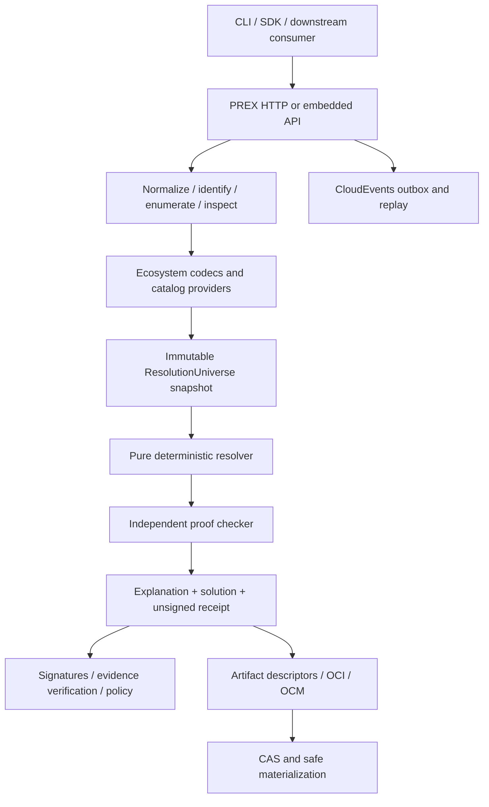

# OpenPacker architecture

## Purpose and boundary

PREX is the vendor-neutral protocol, canonical data model, and conformance
contract. OpenPacker is its reference implementation. Epoch and other downstream
systems consume only the published SDK, embedded API, schemas, events, receipts,
and artifact ports. They do not enter OpenPacker's package identity, resolver,
persistence, or trust model.

The design preserves distinctions that are easy to erase accidentally:

- names and locations identify mutable histories; digests identify bytes;
- native package archives remain canonical; OCI transports them;
- PREX resolves package and capability graphs; OCM composes deliverables;
- evidence verification produces facts; policy makes acceptance decisions;
- catalog acquisition may use networks and clocks; resolution never does.

## Layering

`spec/prex/v1` is the authority for externally visible protocol shapes. The
contract generator currently emits TypeScript declarations and checked schema
copies from the JSON Schemas. Rust models, conformance vectors, OpenAPI,
AsyncAPI, SDK behavior, and documentation are aligned consumers: they are
validated together, but are not falsely described as generated. Contract changes
begin in the schemas and must repair every checked consumer in the same change.

## Package responsibilities

| Layer       | Packages                                                  | Allowed concerns                                           |
| ----------- | --------------------------------------------------------- | ---------------------------------------------------------- |
| Protocol    | `contracts`, `canonical`, `conformance`                   | Schemas, canonical bytes, media types, vectors             |
| Ecosystems  | `adapter-*`, `catalog`, `provider-*`                      | Native semantics, transport, immutable snapshots           |
| Resolution  | Rust `openpacker-resolver`; `embedded`, `openpacker-wasm` | Pure solve, proof, explanation, WASM                       |
| Artifacts   | `artifact-*`, `oci`, `ocm`, `chunking`, `materializer`    | Native bytes, descriptors, safe extraction                 |
| Trust       | `trust`, `policy`, `lifecycle`, `receipts`                | Evidence facts, lifecycle reduction, decisions, signatures |
| Delivery    | `openpackerd`, `sdk`, CLI, mise                           | HTTP, persistence, credentials, retries, operator UX       |
| Integration | `events`, `testkit`, examples                             | Generic ports, CloudEvents, downstream contracts           |

Protocol and resolver layers cannot import Fastify, SQLite, a registry client,
credentials, process execution, Epoch, or ATProto. Ecosystem codecs are pure;
provider network access is injected. Browser entry points cannot import Node
built-ins.

## Deterministic resolution flow

1. Normalize identity, constraints, target, policy, semantics, objectives, and
   evaluation time.
2. Acquire provider records and freeze them into a canonical, digest-addressed
   `ResolutionUniverse`.
3. Give the complete universe to the pure resolver. The resolver has no
   filesystem, network, clock, randomness, credential, or process access.
4. Canonically assign IDs, solve the explicit IR, and emit a proof and
   explanation graph.
5. Check the proof independently against the request and universe. Small
   fixtures also compare the optimum with exhaustive search.
6. Canonicalize the result and unsigned receipt. Signatures bind the receipt
   digest but are not part of it.
7. Materialize only after resolution, from immutable descriptors whose bytes,
   sizes, trust evidence, and policy have been checked.

Canonical collections are sorted before hashing. No protocol digest includes
transport headers, correlation IDs, provider timing, credentials, mutable
artifact locations, wall-clock reads, or signatures over itself.

## Trust composition

Trust is a graph, not a boolean. OCI digests establish byte identity. TUF
protects rollback-sensitive repository metadata. Sigstore binds signatures to
identity and transparency evidence. SLSA describes production. CycloneDX
describes contents and licenses. Lifecycle records eligibility. OCM describes
components. Policy evaluates the resulting typed facts. The PREX receipt binds
the exact request, target, policy, snapshots, lifecycle root, semantics,
objectives, solution, proof, artifacts, and resolver build.

Evidence results distinguish `valid`, `invalid`, `not-provided`, `unknown`,
`not-applicable`, and `policy-denied`; absence never becomes validity.

## Runtime modes

Service mode uses `openpackerd` through `@openpacker/sdk`. Embedded mode passes
serialized snapshots to the native or WASM resolver/verifier. Both consume the
same canonical fixtures and must emit identical request, universe, solution, and
unsigned-receipt digests. The daemon adds transport, SQLite indexes, an event
outbox, provider access, credential lookup, and a filesystem CAS, but no new
PREX semantics.

## Artifact flow

Native archives are stored unchanged in a digest-addressed store and OCI Image
Layout. OCI manifests annotate exact PURLs and attach receipts, overlays, chunk
indexes, SBOMs, and provenance as referrers. OCM descriptors reference selected
components without making a registry location part of identity. Materialization
verifies the descriptor and bytes before bounded extraction to an isolated
staging prefix, rejects filesystem escapes and special files, and never executes
lifecycle scripts.

## Extension and downstream boundary

Extensions implement versioned `CatalogProvider`, `EcosystemCodec`,
`ArtifactSource`, `ArtifactSink`, `ReceiptSigner`, `EvidenceVerifier`,
`PolicyRule`, `EventSink`, `Clock`, or `CredentialResolver` contracts and
declare capabilities, configuration schemas, determinism, and security
boundaries. Generic `externalRefs` may carry downstream IDs without changing
canonical OpenPacker identity or digests.

Epoch may persist canonical receipts and CloudEvents, project them into its own
views, and mirror referenced artifacts. Epoch remains authoritative for its
history, identities, federation, and delivery topology. OpenPacker never imports
Epoch production packages.

## Build and verification

npm workspaces and Turborepo provide the TypeScript task graph; the Rust 2024
workspace uses stable Rust. `npm run verify` is the only aggregate local gate
and is intentionally fail-closed. Mandatory tests and `npm run demo` use
committed fixtures offline. Public providers, live registries, and external
interoperability tools are separate opt-in checks and cannot replace mandatory
coverage.
