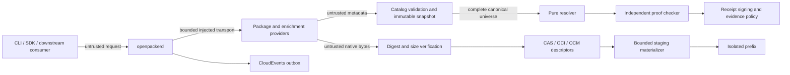
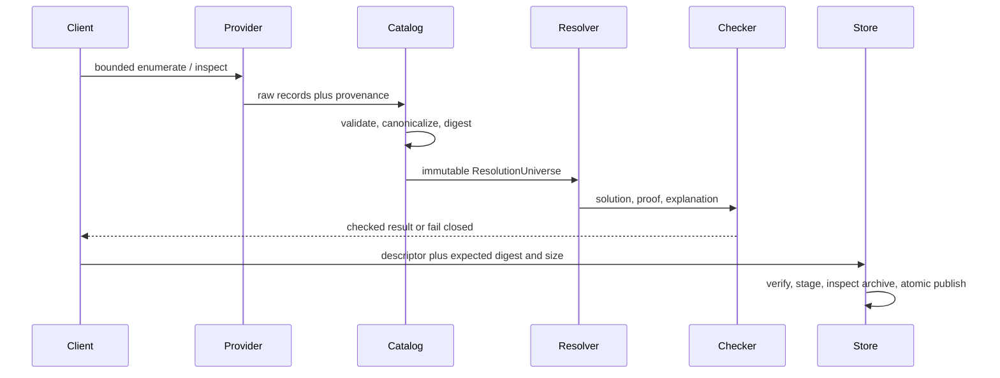

# OpenPacker threat model

## Scope and trust boundaries

PREX requests, provider metadata, native archives, registry responses, OCM
access data, trust evidence, and downstream `externalRefs` are untrusted input.
OpenPacker protects package identity, canonical request and receipt bytes,
immutable snapshots, artifact bytes, resolution proofs, local materialization
prefixes, credentials, and signing keys. Operators remain responsible for host
security, credential provisioning, trusted TUF roots and receipt keys, provider
allowlists, and policy selection.

The provider boundary may use network, credentials, clocks, retries, and
cancellation. The catalog snapshot and resolver boundary may not: resolution
consumes complete canonical input and has no network, filesystem, clock,
randomness, credential, or process-execution capability. The materializer
extracts only after digest and size verification and publishes an atomic prefix
only after all archive checks pass.

## Trust composition

No single `trusted` flag exists. OCI digests establish byte identity; OCM
describes composition; TUF protects rollback-sensitive repository metadata;
Sigstore binds signatures to identity and transparency evidence; SLSA describes
production; CycloneDX describes components and license evidence; lifecycle
records eligibility; policy decides whether the typed facts are acceptable.
Missing evidence remains `not-provided` or `unknown`, never `valid`.

Receipt signatures use runtime WebCrypto Ed25519. A signer receives the UTF-8
`sha256:<hex>` canonical receipt digest, not an incidental JSON serialization.
Signatures remain outside `receiptDigest`. Replay verification separately binds
target, policy, source snapshots, lifecycle root, semantics, objectives,
solution, universe, and resolver build. Fixture private keys under
`fixtures/trust` are public RFC 8032 test vectors and must not be used in
production.

## Threats and controls

| Boundary                         | Threats                                                                                                                                     | Enforced controls                                                                                                                                                                                                                                                                                                                 |
| -------------------------------- | ------------------------------------------------------------------------------------------------------------------------------------------- | --------------------------------------------------------------------------------------------------------------------------------------------------------------------------------------------------------------------------------------------------------------------------------------------------------------------------------- |
| Identity and contracts           | PURL ambiguity, percent encoding, confusables, duplicate JSON keys, oversized metadata, malicious VERS or predicates, unauthorized overlays | Strict schemas and limits, canonical parsers, duplicate-key rejection, provenance-bound overlay authority, negative/property/fuzz vectors                                                                                                                                                                                         |
| Provider network                 | SSRF, redirect downgrade, credential forwarding, retry or decompression exhaustion, stale or substituted snapshots                          | Injectable allowlisted transport, HTTPS and origin checks, credential stripping, bounded redirects/retries/body size, cancellation, ETag revisions, canonical snapshot digests                                                                                                                                                    |
| Resolution                       | Nondeterminism, malformed graphs, lifecycle or semantic-loss omission, objective spoofing, invalid proof acceptance, resource exhaustion    | Pure complete input, canonical ordering, explicit limits and profiles, independent checker, bounded exhaustive oracle, mutated-proof tests                                                                                                                                                                                        |
| Artifact transport               | Digest or size mismatch, OCI subject/blob confusion, cross-origin upload credentials, OCM location coupling, partial-download reuse         | Streamed digest/length checks, strict descriptors and referrers, same-origin upload policy, location-independent OCM projection, atomic CAS commits                                                                                                                                                                               |
| Extraction                       | Traversal, absolute/UNC/drive paths, symlink or hardlink escape, special files, bombs, collisions, unsafe permissions, partial state        | Bounded ZIP/TGZ readers, normalized path checks, entry and expansion limits, staging cleanup, atomic publish, no lifecycle-script execution                                                                                                                                                                                       |
| Install / package execution      | Ambient postinstall, credential theft, host mutation via opmx or host installers, fake isolation when no jail available                     | Deny scripts by default; single `runInSandbox` funnel; native jail first, MXC when asked; fail-closed default; host installers are **user-capability limited**, never a full package-exec jail. **Defense-in-depth, not a microVM or finished OS security product** ([ADR 0036](../adr/0036-sandboxed-installs-and-execution.md)) |
| Trust and lifecycle              | TUF rollback/freeze/mix-and-match, signature or identity substitution, SLSA mismatch, receipt replay, unauthorized restoration              | Explicit trusted roots/keys/time, consistent-snapshot checks, separate evidence facts, canonical signature input, replay bindings, deterministic authorized lifecycle reduction                                                                                                                                                   |
| Supply chain (registry publish)  | Compromised fresh publish, malicious postinstall, exotic transitive git/tarball, trust-tier downgrade, registry substitution, typosquat     | Capture publish time / trust tier / source kind / registry id / script intent; mitigate via minimum release age, trust no-downgrade, exotic source block, script deny-by-default, registry pin, lock + exact snapshot ([supply-chain.md](supply-chain.md), [ADR 0033](../adr/0033-native-supply-chain-capture-and-mitigation.md)) |
| Events and downstream references | Replay, occurrence-ID collision, extension injection changing canonical identity                                                            | Schema validation, canonical data digests, cursor and deduplication rules, declared `externalRefs` outside identity digests                                                                                                                                                                                                       |

## Security test inventory

- [Boundary tests](../../tests/security/boundary.test.mjs) forbid Epoch/ATProto
  production imports, require every archive exploit class, and reject mandatory
  scripts that could install or rebuild package code.
- [Canonical tests](../../packages/canonical/test/canonical.test.ts),
  [daemon tests](../../apps/openpackerd/test/daemon.test.ts), and
  [property tests](../../tests/property) cover canonical bytes, duplicate keys,
  normalization, target predicates, deterministic objectives, and invalid proof
  mutations.
- [Provider transport tests](../../packages/adapter-core/src/index.test.ts) and
  the npm, Cargo, and NuGet adapter tests cover redirects, credential stripping,
  retries, cancellation, ETags, bounded pagination, archive digests, and stable
  errors.
- [Materializer tests](../../packages/materializer/src/index.test.ts),
  [archive vectors](../../fixtures/artifacts/security/archive-cases.json), OCI,
  OCM, and chunking tests cover byte integrity, descriptor validation, safe
  extraction, reconstruction, and cleanup.
- [Trust tests](../../packages/trust/test/trust.test.ts),
  [receipt tests](../../packages/receipts/test/receipts.test.ts), policy,
  lifecycle, and event tests cover rollback, freeze/expiration,
  consistent-snapshot delegation, Sigstore identity, SLSA subjects, replay,
  evidence-state distinctions, authorization, and deduplication.
- [Sandbox escape tests](../../tests/security/sandbox-escape.test.mjs) and
  `packages/sandbox/src/escape.test.ts` are the must-fail jail probes (home
  read, project write, host-install honesty). They skip only when Bubblewrap is
  not on the runner — fail-closed without a backend is still tested.
- `npm run test:security` is the mandatory focused gate; `npm run test:fuzz`,
  `npm run test:conformance`, and the full offline `npm run verify` add bounded
  mutation, schema, cross-runtime, and end-to-end coverage.

## Incident and disclosure

The vulnerability-reporting channel and compromised metadata, artifact, key,
lifecycle-authority, and provider-credential procedure are defined in
[SECURITY.md](../../SECURITY.md). Backup, restore, and air-gap recovery are
defined in the [operations guide](../operations/backup-airgap-recovery.md).
